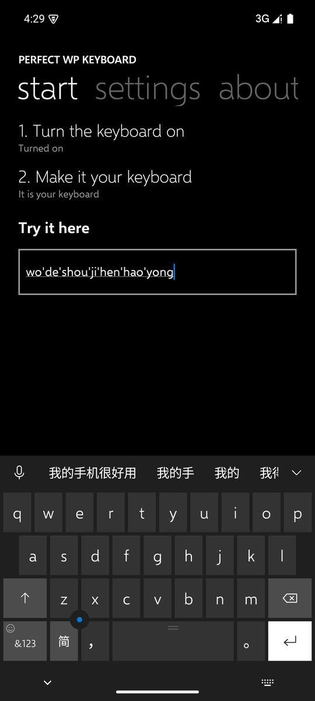
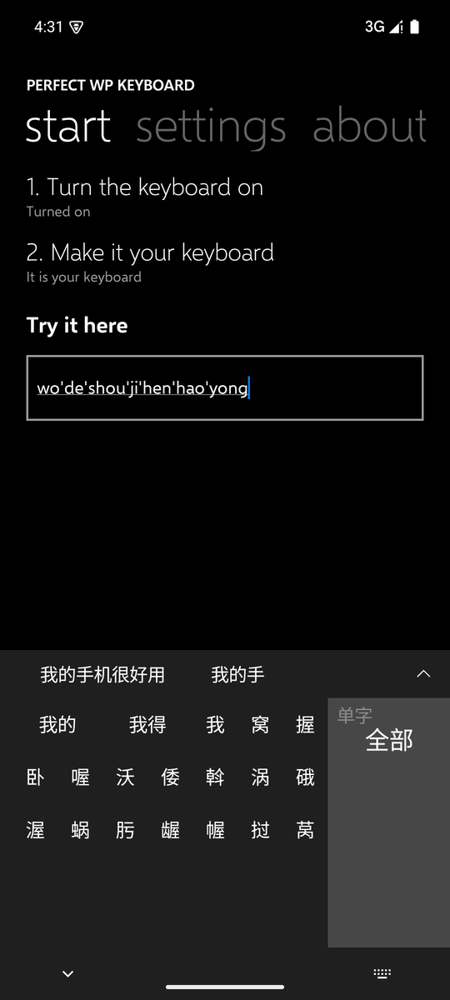
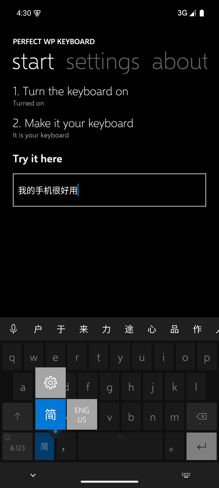
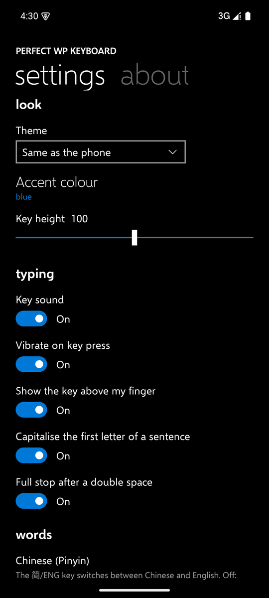

# Perfect WP Keyboard

An Android keyboard that looks and types like the Windows 10 Mobile keyboard: Chinese (Pinyin and Microsoft Shuangpin) and English.

[中文说明](README.zh-CN.md)

<p>
  
  
  
  
</p>

## What it does

**Looks like the phone.** Colours, sizes and shapes were measured on screenshots of a real Windows 10 Mobile phone: the dark keys on a near-black keyboard, the lighter function keys, the white enter key, the thin line glyphs, the smiley in the corner of `&123`, the cursor knob between z and x, the grip on the space bar, the tall accent preview above a pressed key, grey tiles for a held key with the rest of the keyboard sinking back. The type is Selawik, Microsoft's open replacement for Segoe UI.

**Chinese.**
- Full Pinyin or Microsoft Shuangpin (chosen in the settings; with Shuangpin the shift key becomes the `ing` key).
- The first choice is the whole sentence: `womenshizhongguoren` → 我们是中国人, `wodeshoujihenhaoyong` → 我的手机很好用. Every way of cutting the Pinyin into syllables is tried and the likeliest sentence wins.
- Initials and unfinished syllables: `nh` → 你好, `zhongg` → 中国.
- Pick any word and the rest of the Pinyin stays to be chosen. After a choice the bar offers what usually comes next (中 → 国, 心, 文…), and learns what you write after what.
- The arrow at the end of the bar opens every candidate in a seven-column grid, with a switch for single characters.
- About 230,000 words.

**English.** Completion and correction that knows which keys are next to each other (`dont` → `don't`, `teh` → `the`); backspace right after a correction undoes it. Capitals at the start of a sentence, a full stop after a double space.

**More.**
- The `简`/`ENG` key switches language (English starts in small letters); holding it opens the settings and the languages.
- Dictation with the phone's speech recognition, in the Windows 10 Mobile voice panel.
- Slide up from backspace to clear the text, down to bring it back. A held backspace clicks at every character.
- Emoji (hold `&123`), `.com` and the other endings in address fields, the cursor knob to move in four directions.
- What you teach it stays on the phone and can be forgotten with one button. No internet permission.

Android 8.0 or newer.

## Building

```bash
./gradlew assembleDebug
```

The word lists in `app/src/main/assets` are made by `tools/build_dictionaries.py` from the sources below.

## Licence

Apache License 2.0, see [LICENSE](LICENSE) and [NOTICE](NOTICE).

- Chinese words: the Android Open Source Project's PinyinIME (Apache 2.0), word frequencies from [jieba](https://github.com/fxsjy/jieba) (MIT), readings from [phrase-pinyin-data](https://github.com/mozillazg/phrase-pinyin-data) and [pinyin-data](https://github.com/mozillazg/pinyin-data) (MIT).
- English words: the Android Open Source Project's LatinIME (Apache 2.0).
- Typeface: [Selawik](https://github.com/microsoft/Selawik) by Microsoft, SIL Open Font License 1.1 ([licenses/Selawik-OFL-1.1.txt](licenses/Selawik-OFL-1.1.txt)).

Windows and Windows Phone are trademarks of Microsoft Corporation. This project is not affiliated with Microsoft.
