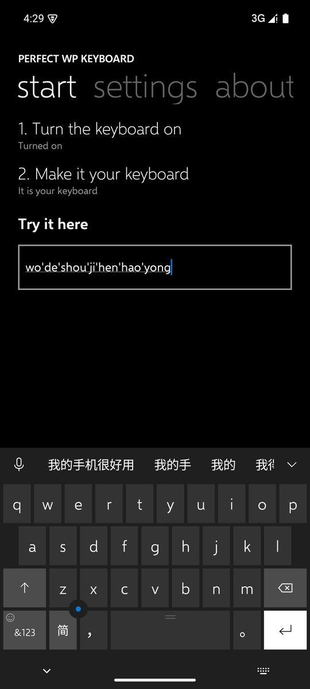
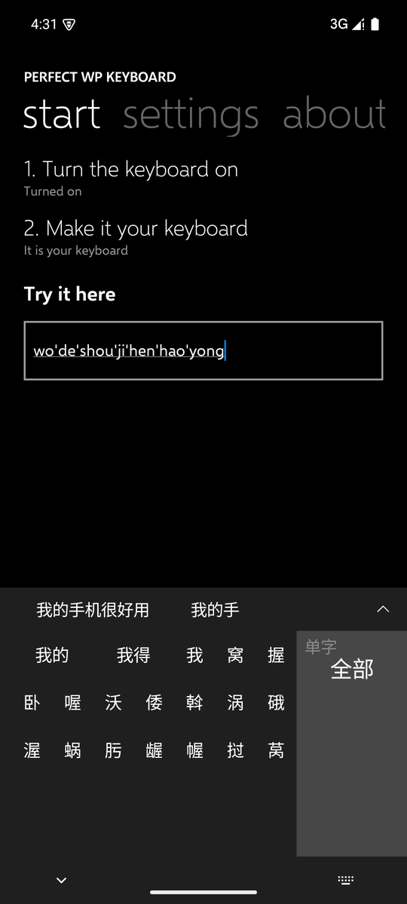
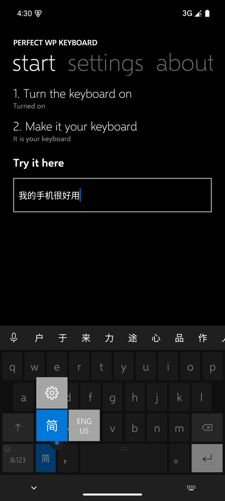
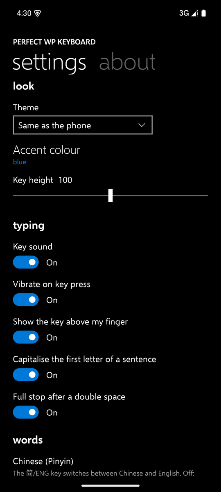

# Perfect WP Keyboard

一款外观和用法都照着 Windows 10 Mobile 键盘做的 Android 键盘：中文（全拼和微软双拼）和英文。

[English](README.md)

<p>
  
  
  
  
</p>

## 功能

**外观照着真机做**：颜色、尺寸和形状都是从 Windows 10 Mobile 真机截图上量出来的：近黑的键盘上深灰的字母键、浅一档的功能键、白色回车键、细线图标、`&123` 角上的笑脸、z 和 x 之间的光标圆钮、空格键上的两道横线、按键时上方高出一截的主题色预览、长按时灰色方块弹出而键盘其余部分变暗。字体是微软开源的 Selawik（Segoe UI 的开源替代）。

**中文**
- 全拼或微软双拼（在设置中选择；双拼时 shift 键变成 `ing` 键）。
- 首选是整句：`womenshizhongguoren` → 我们是中国人，`wodeshoujihenhaoyong` → 我的手机很好用。会尝试拼音的所有切分方式，选概率最高的整句。
- 简拼和不完整的音节：`nh` → 你好，`zhongg` → 中国。
- 选任意一个词，剩下的拼音继续选。选完后候选栏给出常跟在后面的词（中 → 国、心、文…），并记住你自己的搭配。
- 候选栏末尾的箭头把全部候选展开成七列的格子，侧栏可以只看单字。
- 约 23 万条词。

**英文**：补全，以及考虑键盘上相邻按键的拼写纠正（`dont` → `don't`，`teh` → `the`），纠正后马上按退格可以撤销。句首自动大写，双击空格输入句号。

**其他**
- `简`/`ENG` 键切换语言（英文默认小写）；长按出现设置和语言。
- 用手机自带的语音识别听写，界面是 Windows 10 Mobile 的语音面板。
- 从退格键向上滑清空文字，向下滑恢复。按住退格每删一个字都有声音。
- 表情（长按 `&123`）、网址框里的 `.com` 和其他后缀、可以上下左右移动光标的圆钮。
- 学到的东西只保存在手机上，一个按钮就能清除。不需要网络权限。

从 [Releases](https://github.com/abhhba/perfect-wp-keyboard/releases/latest) **下载** APK。需要 Android 8.0 或更高版本。

## 构建

```bash
./gradlew assembleDebug
```

`app/src/main/assets` 里的词库由 `tools/build_dictionaries.py` 从下列数据生成。

## 许可证

Apache License 2.0，见 [LICENSE](LICENSE) 和 [NOTICE](NOTICE)。

- 中文词库：Android 开源项目 PinyinIME（Apache 2.0），[jieba](https://github.com/fxsjy/jieba) 词频（MIT），[phrase-pinyin-data](https://github.com/mozillazg/phrase-pinyin-data) 与 [pinyin-data](https://github.com/mozillazg/pinyin-data) 读音（MIT）。
- 英文词库：Android 开源项目 LatinIME（Apache 2.0）。
- 字体：微软的 [Selawik](https://github.com/microsoft/Selawik)，SIL Open Font License 1.1（[licenses/Selawik-OFL-1.1.txt](licenses/Selawik-OFL-1.1.txt)）。

Windows 和 Windows Phone 是微软公司的商标。本项目与微软无关。
